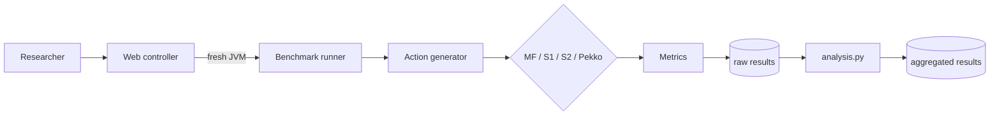

# Экспериментальный стенд ВКР

Документ привязан к требованиям практической работы №3 «Критерии научности исследования и проектирование экспериментального стенда».

## 1. Назначение

Стенд предназначен для воспроизводимой проверки свойств backend-фреймворка масштабируемых мультиплеерных Web-приложений. Основной SUT - execution runtime `multiplayer-framework`. Сравнительные реализации S1/S2/Pekko являются matched baselines: они выполняют одинаковую лёгкую session-level логику, но используют разные механизмы сериализации и планирования.

Стенд разделён на пять требуемых элементов:

1. **SUT:** Multiplayer Framework и три baseline runtime.
2. **Источник воздействия:** детерминированный генератор Actions и периодических session steps.
3. **Сбор измерений:** Action latency, step lateness, throughput, rejects, backlog, CPU, heap, thread count.
4. **Хранилище:** immutable каталог каждого эксперимента с manifest, run-config, raw CSV, summary, logs и SHA-256.
5. **Анализ:** `scripts/analyze.py`, который агрегирует независимые JVM-runs и формирует `analysis.json`/`analysis.csv`.

## 2. Архитектура

Исходник диаграммы хранится в `docs/architecture.mmd`.



Контроллер и измеряемый runtime не находятся в одной JVM. Каждый repetition создаёт новый `java` process, поэтому JVM state, JIT state и heap не переносятся между независимыми прогонами.

## 3. Компоненты

| Компонент | Роль | Технология / версия | Обоснование |
|---|---|---|---|
| Web/controller | Оркестрация, randomization, история | Python 3.10+, FastAPI 0.162.0 | Контроллер не участвует в scheduler hot path и только создаёт дочерние JVM |
| Runner | Один независимый прогон | Java 17 | Совпадает с платформой SUT |
| Multiplayer Framework | Основной SUT | Maven `com.mf:mf-game-service-starter:0.5.0-SNAPSHOT` до выпуска фиксированного release | Используется фактический runtime-код, а не модель |
| S1 | Baseline | Java single-thread scheduled executor/session | Наивная сериализация с execution resource per session |
| S2 | Baseline | Java fixed shared pool + serial queue/session | Ближайшая generic-executor альтернатива |
| S3 | Baseline | Apache Pekko 1.7.1 | Actor-style serialized execution на общем dispatcher |
| Histogram | Percentiles | HdrHistogram 2.2.2 | Корректное накопление распределений latency без хранения каждого события |
| Storage | Raw data | persistent Docker volume | Результаты не удаляются при redeploy |
| Analysis | Статистика | Python stdlib | Median, min-max, deterministic bootstrap 95% CI; A/A permutation test |
| DPM | Deployment | Dimka Project Manager + Docker Compose | Git commit + Compose являются deployment source of truth |

**Важно:** пока SUT публикуется как `0.5.0-SNAPSHOT`, полная reproducibility ограничена изменяемостью snapshot-артефакта. Перед итоговыми прогонами ВКР необходимо выпустить фиксированный Maven release/tag и заменить координату в `runner/pom.xml`.

## 4. Окружение

Целевой сервер для основного эксперимента: 4 vCPU, 8 GB RAM, Linux, Java 17, heap `-Xms4g -Xmx4g`, G1GC. Compose ограничивает benchmark service четырьмя CPU и 7 GB RAM, оставляя резерв ОС/DPM. Во время итоговых прогонов остальные пользовательские проекты на этой VM должны быть остановлены либо эксперимент должен запускаться на выделенной VM.

WebSocket/STOMP намеренно исключён из scheduler benchmark. Это отделяет стоимость execution architecture от брокера, сериализации WebSocket и сетевого RTT. End-to-end Web transport должен проверяться отдельным экспериментом, если он войдёт в исследовательский вопрос ВКР.

## 5. План эксперимента

Основной факторный план:

- runtime: `mf`, `s1`, `s2`, `pekko`;
- sessions: 100, 250, 500, 750, 875, 1000, 1125;
- simulation: 50 Hz;
- publication: 20 Hz;
- workers: 4;
- Action capacity C: 2048;
- per-step budget B: 256;
- offered Actions: 10,000 Actions/s для session-density sweep; отдельный throughput sweep может варьировать Action rate;
- warm-up: 120 s, не входит в измерение;
- measurement: 180 s;
- independent repetitions: 10;
- JVM restart: перед каждым repetition;
- порядок всех `(runtime, sessions, repetition)` рандомизируется фиксированным seed `20261105`.

Полный план содержит 4 × 7 × 10 = 280 независимых JVM-прогонов. Для демонстрации предусмотрен `smoke` preset, который не используется для научных выводов.

**Единица анализа:** один независимо перезапущенный JVM-run. Отдельные Actions внутри одного run не считаются независимыми наблюдениями.

## 6. Операциональные метрики

- **Action latency:** `System.nanoTime()` от успешного admission Action до входа в session callback, ms; p50/p95/p99.
- **Step lateness:** положительная разница между фактическим началом session step и ожидаемым 50 Hz deadline, ms; p50/p95/p99.
- **Throughput:** число выполненных Actions / длительность measurement window, Actions/s.
- **Rejection rate:** rejected / offered Actions.
- **Backlog:** accepted - processed Actions; дополнительно оценивается наклон backlog за последние samples.
- **CPU:** process CPU load JVM, % host CPU budget.
- **Heap:** used JVM heap, bytes.
- **Threads:** JVM live thread count.
- **Achieved tick fraction:** observed steps/s / (`sessions × target Hz`).

### Критерий `sustained`

Load point считается устойчивым, если медианный run удовлетворяет одновременно:

- p99 step lateness < 10 ms;
- p99 Action latency < 30 ms;
- rejection rate ≤ 0.1%;
- achieved tick fraction ≥ 98% target cadence;
- backlog не имеет устойчивого положительного роста более 1 Action/s в конце measurement window.

Пороговые значения зафиксированы до анализа полного эксперимента; изменение порогов после просмотра результатов должно оформляться как отдельный анализ чувствительности.

## 7. Статистическая обработка

Для каждой конфигурации рассчитываются median, min-max и bootstrap 95% CI медианы по независимым runs. Bootstrap использует фиксированный seed из manifest. Для A/A-проверки одинаковая конфигурация запускается 10 раз; runs делятся на две половины, а разница медиан p99/CPU проверяется двухсторонним permutation test. В итоговой ВКР следует дополнительно показывать все точки runs на графике, чтобы диапазон не скрывал выбросы.

## 8. Проверка самого стенда

1. **Smoke:** проверяет, что все четыре runtime запускаются и сохраняют артефакты.
2. **A/A:** `configs/aa.json`; одинаковый MF workload, 10 runs. Значимое систематическое расхождение требует поиска дрейфа окружения/нагрузки.
3. **Generator sanity:** `offeredActions` должен соответствовать заданному Action rate; рост backlog или недобор offered load фиксируется в raw samples.
4. **Clock:** latency измеряется монотонным `System.nanoTime()`, а wall clock используется только для метаданных.
5. **Failure transparency:** child JVM failure не уничтожает experiment; run получает log/summary и experiment завершается `completed_with_failures`.

## 9. Угрозы валидности и меры

| Угроза | Мера |
|---|---|
| Фоновые процессы на общей VM | Остановить остальные DPM projects или использовать dedicated VM; рандомизировать порядок |
| JIT/GC warm-up | 120 s warm-up; fresh JVM; фиксированный heap/GC |
| Генератор становится bottleneck | Параллельные producer threads; offered rate и backlog сохраняются в raw data |
| Неэквивалентность baseline | Одинаковые session callback arithmetic, C/B, tick/publication cadence и offered trace; отличается scheduling model |
| Snapshot dependency меняется | Перед финальными runs заменить SNAPSHOT фиксированным release/tag |
| Synthetic workload не равен реальной игре | Ограничить external-validity claim; отдельно возможно добавить `tank-game` workload |
| Transport исключён | Не переносить scheduler latency на browser RTT; WebSocket/STOMP исследовать отдельно |
| Correlated requests | Единица анализа - whole run, а не отдельный Action |

## 10. Воспроизводимость

Код фиксируется Git commit/tag; зависимости - точными Maven/Python версиями; окружение - Dockerfile/Compose; параметры - JSON config; randomization seed - в manifest; запуск - Makefile/API; raw data и metadata - persistent volume; checksums - SHA-256; CI собирает runner и тестирует controller.

Сценарий независимой проверки:

```bash
cp compose.env.example /etc/multiplayer-framework-benchmark/compose.env
# настроить MAVEN_SETTINGS_FILE с read access к GitHub Packages
docker compose up -d --build
curl http://localhost:8080/benchmark/api/health
make smoke
```

Проверяющий должен получить completed smoke experiment, каталоги `runs/*` с `samples.csv`, `summary.json`, `runner.log`, `checksums.sha256`, а в корне эксперимента - `manifest.json`, `analysis.json`, `analysis.csv`. Для performance-значений допускается расхождение, обусловленное CPU/виртуализацией; совпадать должны qualitative ordering/contract criteria только после фиксации одинакового hardware profile.
